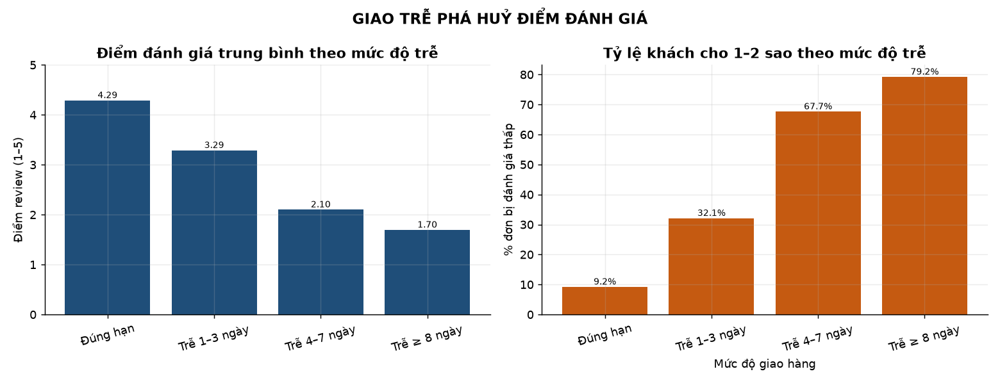
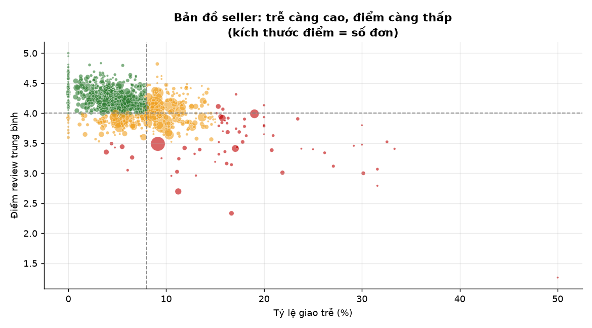
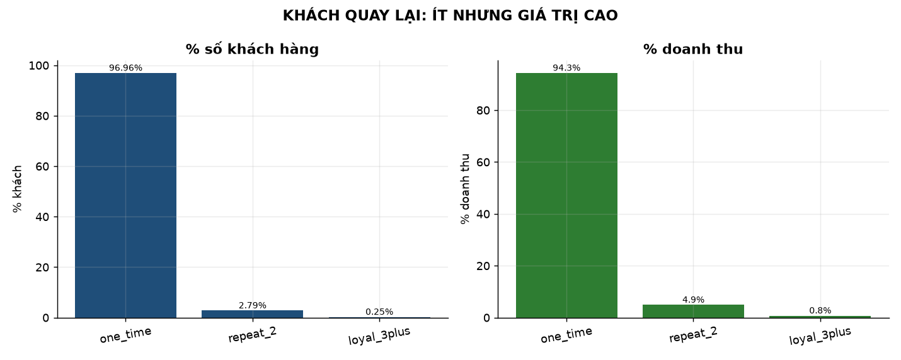

# Olist E-Commerce Analytics

Phân tích end-to-end dữ liệu sàn thương mại điện tử **Olist** (Brazil): 99.441 đơn hàng,
3.095 người bán, 73 ngành hàng. Stack **Python + SQLite**, kết quả gồm SQL, CSV, 17 chart và báo cáo.

**Câu hỏi trung tâm:** *Olist tăng trưởng nhanh nhưng khách không quay lại — vấn đề nằm ở đâu?*

---

## Kết quả chính

| Phát hiện | Con số |
|---|---|
| Giao trễ làm mất **2,02 sao** | 4,29 ⭐ → 2,27 ⭐ |
| Khách giao trễ cho 1–2 sao nhiều gấp **6,7 lần** | 62,41% vs 9,25% |
| Chỉ **3,04%** khách quay lại mua lần 2 | khách quay lại đáng giá gấp 1,8–3,1 lần |
| **67 seller** rủi ro chiếm 6,15% doanh thu | 18,06% đơn trễ (gấp 5 lần nhóm healthy) |
| **RJ** trễ gấp 2,7 lần **SP** dù chỉ cách ~430 km | 12,15% vs 4,50% |

👉 Báo cáo đầy đủ: **[`docs/findings.md`](docs/findings.md)**

### Vài hình ảnh

**Giao trễ phá huỷ điểm đánh giá** — chỉ trễ 1–3 ngày đã mất gần 1 sao:



**Seller: trễ càng cao, điểm càng thấp** — mỗi điểm là một seller, kích thước = số đơn:



**Khách quay lại ít nhưng giá trị cao gấp 1,8–3,1 lần:**



*(17 chart đầy đủ trong [`reports/figures/`](reports/figures/))*

---

## Chạy dự án

```bash
python -m pip install -r requirements.txt
python run_all.py
```

Pipeline gồm 5 bước, chạy tuần tự:

```
download_data  →  build_db  →  transform  →  validate  →  run_marts
  9 CSV            staging       dim/fact      40 luật     14 bảng mart
                                                        + 17 chart PNG
```

- `validate` tự dừng với exit code 1 nếu có luật nào FAIL.
- Kết quả: `data/processed/olist.db`, CSV trong `reports/`, chart trong `reports/figures/`.

> **Nguồn dữ liệu:** [Brazilian E-Commerce Public Dataset by Olist](https://www.kaggle.com/datasets/olistbr/brazilian-ecommerce) (Kaggle),
> license **CC BY-NC-SA 4.0** — dùng cho mục đích học tập/portfolio, không dùng thương mại.
> Dự án không phân phối lại dữ liệu; tải bằng `python -m src.etl.download_data`
> (mirror công khai trên Hugging Face, không cần tài khoản Kaggle).

---

## Kiến trúc

```
stg_*  (9 bảng, mọi cột TEXT, bản sao nguyên trạng)
  ↓
dim_date · dim_customer · dim_product · dim_seller · dim_geolocation
fact_orders · fact_order_items · fact_payments
  ↓
mart_*  (14 bảng, sinh từ SQL)
  ↓
CSV + 17 chart PNG + docs/findings.md
```

| Tầng | Vai trò |
|---|---|
| `stg_*` | Bản sao nguyên trạng file CSV. Cột `TEXT` để **không có phép ép kiểu nào** làm đổi giá trị gốc. |
| `dim_*` / `fact_*` | Star schema. `fact_orders` (grain = đơn) tách khỏi `fact_order_items` (grain = dòng hàng) để tránh fan-out. |
| `mart_*` | Kết quả phân tích, viết bằng SQL trong `sql/03_analysis/`. |

---

## 6 bẫy dữ liệu đã xử lý

| # | Bẫy | Hậu quả nếu bỏ qua |
|---|---|---|
| B1 | `customer_id` **không phải** khách hàng (1 đơn = 1 mã) | Tỷ lệ khách quay lại = **0%** (sai hoàn toàn) |
| B2 | 547 đơn có 2–3 review | Join nhân dòng, điểm TB lệch |
| B3 | `order_id` trong bảng reviews không unique | Cùng B2 |
| B4 | Geolocation 1.000.163 dòng cho 19.015 mã zip | Join trực tiếp làm nổ số dòng |
| B5 | 42 toạ độ nằm ngoài lãnh thổ Brazil | Bản đồ có điểm ở châu Á |
| B6 | 2 danh mục thiếu bản dịch | Báo cáo hiện `<NA>` |

Thêm: file reviews có **104.719 dòng vật lý nhưng 99.224 bản ghi** (comment chứa ký tự
xuống dòng) — đếm dòng thô sẽ sai.

---

## Kiểm tra chất lượng (40 luật)

| Nhóm | Nội dung |
|---|---|
| A | Số dòng staging = số bản ghi CSV |
| B | **Hash từng dòng** — chứng minh staging giữ nguyên 100% giá trị gốc |
| C | 6 quan hệ khoá ngoại, 0 orphan |
| D | Ràng buộc nghiệp vụ (tổng tiền khớp tuyệt đối, điểm review 1–5, toạ độ hợp lệ…) |
| E | Đặc điểm đã biết (ghi nhận, không phải lỗi) |

Kết quả: **40 PASS / 0 FAIL / 5 INFO**.

---

## Cấu trúc thư mục

```
docs/             tài liệu thiết kế, từ điển dữ liệu, báo cáo kết quả
sql/schema.sql    DDL 3 tầng
sql/03_analysis/  9 file SQL, mỗi file 1 mảng phân tích
src/etl/          download_data, build_db, transform, validate
src/analysis/     run_marts (chạy SQL + xuất CSV + vẽ chart)
notebooks/        01_explore.ipynb — EDA trình bày
reports/          14 CSV + figures/ 17 chart PNG
data/             dữ liệu thô và database (không commit)
```

---

## Tài liệu

| File | Nội dung |
|---|---|
| `docs/00_START_HERE.md` | Bản đồ đọc tài liệu |
| `docs/idea.md` | Thiết kế, 8 quyết định, gap analysis, star schema |
| `docs/data_dictionary.md` | Ý nghĩa từng cột + số liệu khảo sát thật + 6 bẫy |
| `docs/getting_data.md` | 3 cách tải dữ liệu |
| `docs/findings.md` | **Báo cáo kết quả** |
| `notebooks/01_explore.ipynb` | EDA tương tác |

---

## Hạn chế

Dataset **không có**: giá vốn, chi phí marketing/traffic, tên đơn vị vận chuyển,
lý do huỷ đơn, nhân khẩu khách. Vì vậy dự án **không** kết luận về biên lợi nhuận,
CAC/LTV hay tỷ lệ chuyển đổi.

Phân tích giao trễ ↔ điểm review là **tương quan quan sát**, không phải quan hệ nhân quả
đã kiểm chứng bằng thí nghiệm.
